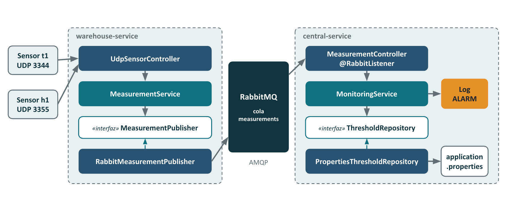

# Warehouse Monitoring

Monitors temperature and humidity in warehouses and raises an alarm when a value goes above its limit.

## How it works



1. Each sensor sends its reading by UDP to its warehouse (for example `sensor_id=t1; value=36`).
2. The **warehouse service** checks the reading and sends it to RabbitMQ.
3. **RabbitMQ** keeps the readings in the `measurements` queue.
4. The **central service** reads the queue and logs an `ALARM` if a value is above its limit.

Invalid readings are logged and ignored.

## Limits

| Sensor      | Limit |
|-------------|------:|
| Temperature | 35 °C |
| Humidity    | 50 %  |

## Built with

Java 21 · Spring Boot 3.5.16 · RabbitMQ 4.1 · Docker Compose

## Setup

Requirements: Docker and netcat (`nc`).

1. Clone the repository:
   ```
   git clone https://github.com/marioestebanortega/warehouse-monitoring.git
   cd warehouse-monitoring
   ```
2. Create the RabbitMQ credentials file:
   ```
   cp .env.example .env
   ```
   The demo user and password work as they are for local use: Docker Compose gives the same values to RabbitMQ and to the services. You can change them if you want.
3. Start everything:
   ```
   docker compose up --build
   ```

UDP ports on your machine:

| Warehouse   | Temperature | Humidity |
|-------------|------------:|---------:|
| warehouse-1 |        3344 |     3355 |
| warehouse-2 |        4344 |     4355 |

## Try it

In another terminal, send readings:

```
echo -n "sensor_id=t1; value=30" | nc -u -w1 localhost 3344   # no alarm
echo -n "sensor_id=t1; value=36" | nc -u -w1 localhost 3344   # ALARM
echo -n "sensor_id=h1; value=55" | nc -u -w1 localhost 3355   # ALARM
echo -n "not valid" | nc -u -w1 localhost 3344                # invalid reading
echo -n "sensor_id=t7; value=41" | nc -u -w1 localhost 4344   # ALARM from warehouse-2
```

See the logs:

```
docker compose logs -f central warehouse-1 warehouse-2
```

Stop everything with `docker compose down`.

## Tests

Requirements: Java 21 and Maven.

```
mvn verify
```

The coverage report is in `<module>/target/site/jacoco/index.html`.

## User stories

| #  | Story                                     | Issue |
|----|-------------------------------------------|-------|
| 00 | Project setup                             | #1    |
| 01 | Read a sensor message                     | #2    |
| 02 | Limits per sensor type                    | #3    |
| 03 | Raise an alarm                            | #4    |
| 04 | Send readings to the central service      | #5    |
| 05 | Receive readings from sensors             | #6    |
| 06 | Connect warehouses and central service    | #7    |
| 07 | Testing and prove all                     | #8    |
